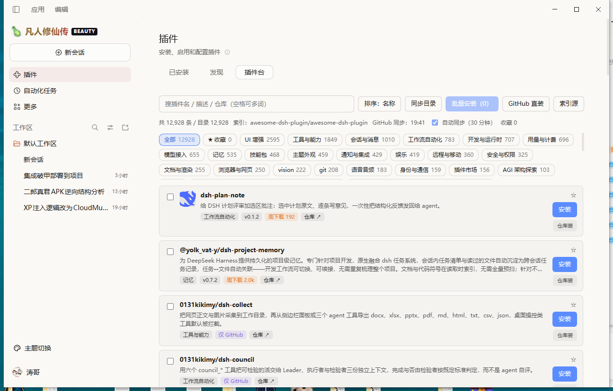
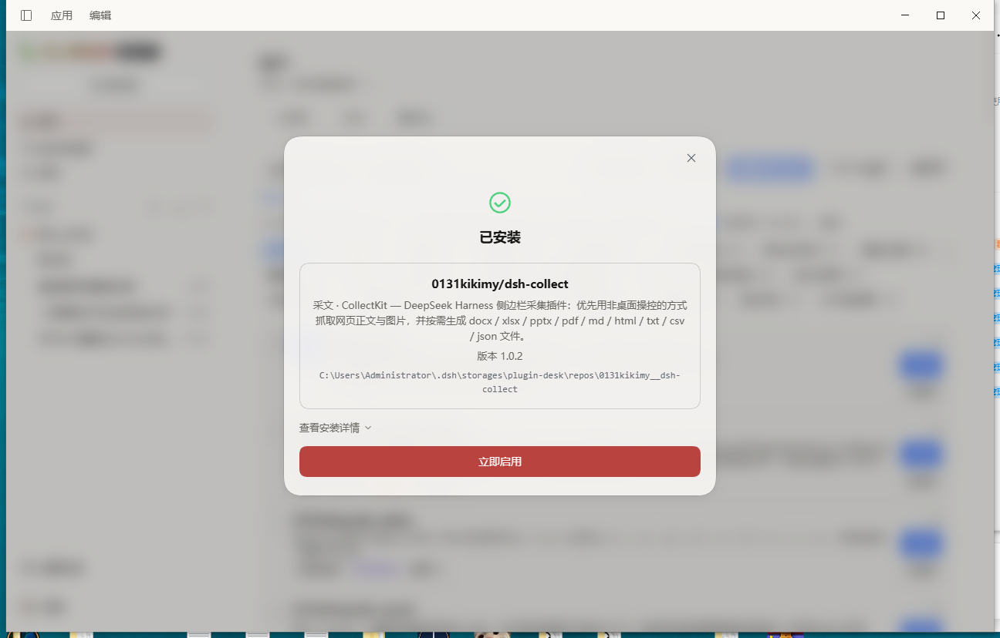
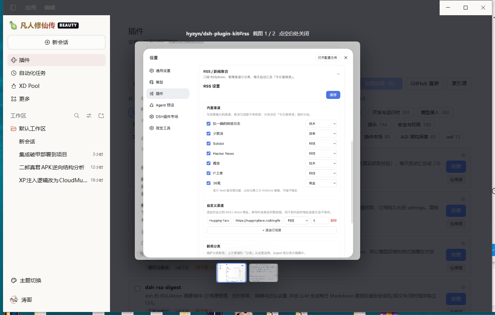

# DSH Plugin Desk

An extra **Plugin Desk** tab inside DSH's (DeepSeek Harness) **Plugins** page. It syncs **every plugin** listed in the
GitHub repo [`awesome-dsh-plugin/awesome-dsh-plugin`](https://github.com/awesome-dsh-plugin/awesome-dsh-plugin) —
**12,928 entries** — to your machine, with search, categories, stars, download counts and screenshot previews.
"Install" always goes through DSH's official installer.

[中文说明](README.md)



## Why

The built-in "Discover" page only reads the web index (6,885 entries), has no popularity or favorites, and — the
bigger problem — **plugins that were never published to npm simply cannot be installed**. Plugin Desk instead reads
the full data set straight out of the GitHub repo (12,928 entries), and it works around the case where the machine
has no `git` installed (where `git+https` specs fail with `ERR_PNPM_GIT_RESOLVE_FAILED`).

## Features

- **Full catalog** — one tarball download (~9 MB) of the repo, gunzipped and untarred in memory, then every
  `data/plugins/*.yml` (12,976 files) is parsed into 12,928 entries. ~14 s cold sync, cached on disk for 12 h.
- **Auto sync** — silently re-fetches every 30 minutes (skipped while the page is hidden, can be turned off in the
  header); a "Sync" button forces a refresh at any time.
- **Search** — space-separated AND terms, matched against package name, repo, Chinese/English description and
  category.
- **Category chips** — sorted by count (UI enhancements 2595, Tools & capabilities 1849, Sessions & messages 1010 …)
  plus a virtual **★ Favorites** category.
- **Previews** — ★ stars, GitHub download count, added date, repo icon, `N screenshots` with a full-screen overlay
  and thumbnail switcher.
- **Three install paths**, all handed to the official `install()`:
  1. npm package known → `name@version`;
  2. repo publishes a release `.tgz` → plain https URL;
  3. GitHub-only repo (no npm) → the host downloads the repo tarball over HTTPS, extracts it to
     `~/.dsh/storages/plugin-desk/repos/`, and passes the **local directory** to the official installer.
- **Batch install** — select many, queue them; the official dialog is opened one at a time with the queue panel
  tracking *success / unconfirmed*.
- **GitHub direct install** — paste `owner/repo` or a full URL, same third path as above.
- **Pluggable index source** — point it at your own `https://raw.githubusercontent.com/<owner>/<repo>/<branch>/index.json`
  (https only, host allowlist, `.json` required).

## Install

```bash
dsh plugin --profile desktop add <this-dir>/dsh-plugin-desk
```

Or on Windows, double-click `install/install-desktop.cmd`.

`dsh plugin add` writes both `dependencies` and `dsh.profile.bundles` (so it is enabled immediately) and a running
DSH hot-loads it. If the tab does not appear, quit DSH completely and start it again.

Uninstall: `dsh plugin --profile desktop remove dsh-plugin-desk`.

## What it looks like

The Plugins page gains a tab row: `Installed | Discover | Plugin Desk`. Click **Plugin Desk** and you get the first
screenshot above.

Installing a GitHub-only repo (the official dialog reports "installed 1.0.2" from the extracted local directory):



Screenshot preview:



## Architecture

```
plugins.tab slot → lib/client.js   (React UI; ctx.slots.register({ name: 'plugins.tab', id: 'desk' }))
        │ fetch
        ▼
webServer, four read-only GET routes → lib/index.js
   /api/plugin-desk/catalog     full GitHub catalog (12,928) + npm version enrichment; ?refresh=1 forces,
                                ?source= switches index source
   /api/plugin-desk/prepare     ?repo=<github url> downloads a repo into a local directory (install path 3)
   /api/plugin-desk/heat        ?names=a,b weekly downloads (registry.npmmirror.com first, api.npmjs.org fallback)
   /api/plugin-desk/installed   scans ~/.dsh/profiles/*/package.json to see what is already installed
```

- Everything is a GET, loopback-only; the host never writes the profile and never runs pnpm.
- Cache: `~/.dsh/storages/plugin-desk/{repo-index.json,catalog.json,repos/}`.
- Why not `git+https`: `git` is frequently missing on the machine, so pnpm fails with
  `ERR_PNPM_GIT_RESOLVE_FAILED`. Downloading over HTTPS and installing from a local directory is reliable.

## Known limitations

- Screenshots exist only for plugins that registered them (~179 of 12,928); no screenshots, no preview button.
- Stars / downloads / added date are periodic snapshots from the upstream repo, not live APIs.
- The batch queue decides "success" by the package name appearing in the installed list. For GitHub-only repos the
  real package name can differ from `owner/repo`, so it shows *unconfirmed* even though it did install — check the
  Installed tab.
- Batch install still requires confirming each official dialog; the supply-chain prompt cannot be skipped.
- Favorites, last search term and index source live in `localStorage` under `dsh-plugin-desk:*`.

## Release

Tags matching `v*` trigger `.github/workflows/release.yml`, which zips the plugin package and publishes it as a
GitHub Release asset. Pushing a tag is all it takes:

```bash
git tag v0.2.0 && git push origin v0.2.0
```

## License

MIT — see [LICENSE](LICENSE). Data belongs to the respective plugin authors and the awesome-dsh-plugin repo.
