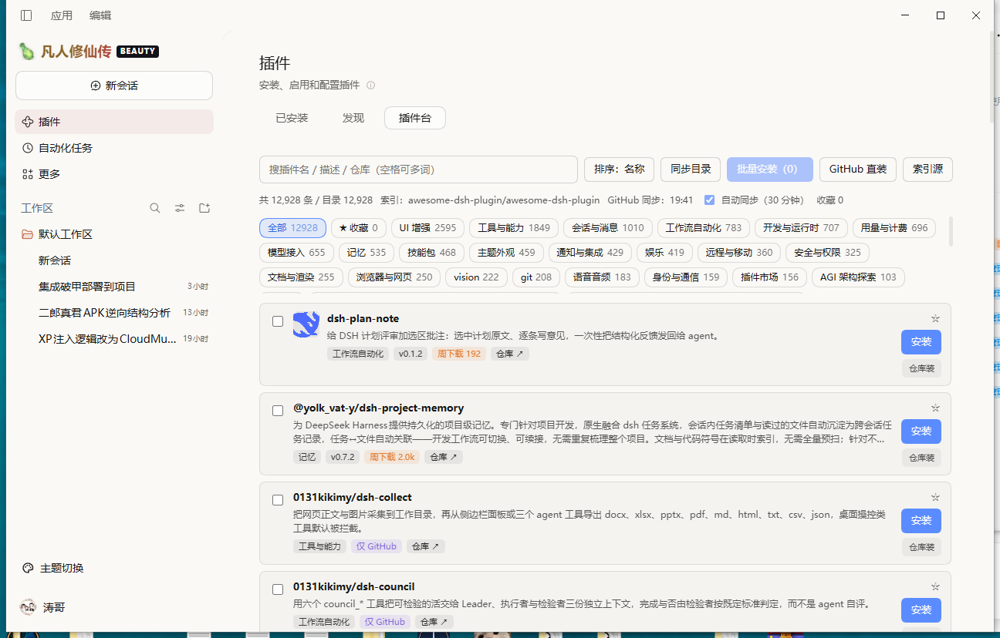
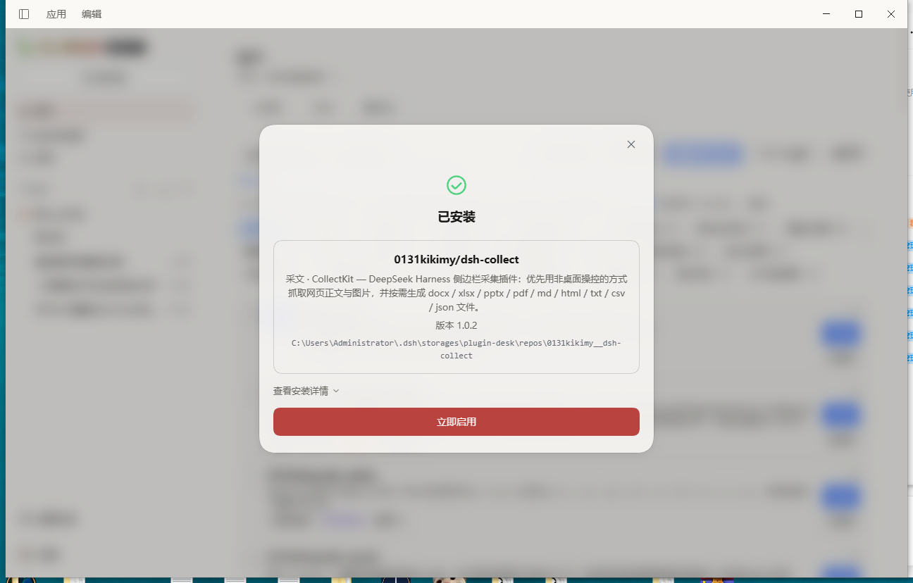
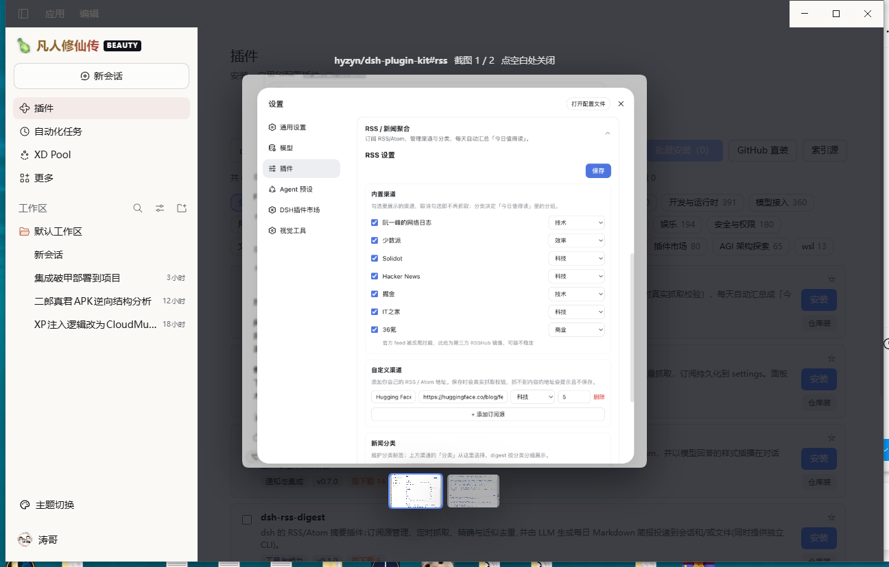

# DSH Plugin Desk · DSH 插件台

[中文](#中文) | [English](#english) | [English README（独立文件）](README.en.md)

在 DSH（DeepSeek Harness）的 **插件** 页里加一个 **插件台** 标签页：把 GitHub 仓库
[`awesome-dsh-plugin/awesome-dsh-plugin`](https://github.com/awesome-dsh-plugin/awesome-dsh-plugin)
里 **12,928 个插件**全部同步到本地，能搜、能分类、能看星标 / 下载量 / 截图，点「安装」就走官方安装链路。

A plugin tab for DSH's Plugins page. It syncs every plugin (12,928 entries) from the
`awesome-dsh-plugin` GitHub repo, renders stars / downloads / screenshots, and installs through
DSH's official installer — npm, release tarball, or a plain GitHub repository.



---

## 中文

### 为什么做这个

DSH 内置的「发现」页只读网页索引（6,885 条），而且没有热度、收藏和批量；更麻烦的是**没发 npm 的插件根本装不了**。
这个插件台改成直接啃 GitHub 仓库的全量数据（12,928 条），并解决了本机没装 git 时 `git+https` 装不上的问题。

### 功能

- **全量目录**：一次下载仓库 tarball（约 9 MB），在内存里解 tar.gz 解析 `data/plugins/*.yml`（12,976 个文件），
  冷同步约 14 秒，落盘缓存 12 小时。
- **自动同步**：每 30 分钟静默重拉一次（页面不可见时跳过，头部可勾掉）；「同步目录」随时强制刷新。
- **搜索**：空格分词 AND，匹配包名 / 仓库 / 中英描述 / 分类中文名。
- **分类 chips**：按条数排序（UI 增强 2595、工具与能力 1849、会话与消息 1010 …）+ 虚拟分类「★ 收藏」。
- **预览**：`★ 星标`、`GitHub 下载量`、`收录日期`、仓库图标、`预览 N 图`（全屏浮层 + 缩略图切换）。
- **三种安装方式**，全部交给官方 `install()`：
  1. 有 npm 包名 → `包名@版本`；
  2. 仓库有 release `.tgz` → 直接给 https 地址；
  3. 纯 GitHub 仓库（无 npm）→ 宿主用 HTTPS 拉仓库 tarball 解到 `~/.dsh/storages/plugin-desk/repos/`，把**本地目录**交给官方安装。
- **批量安装**：勾多条 → 排队依次弹官方安装框，装完一个自动进下一个，队列显示 成功 / 未确认。
- **GitHub 直装**：手填 `owner/repo` 或完整地址，同样走第 3 条链路。
- **索引源**：可换成自己的 `https://raw.githubusercontent.com/<owner>/<repo>/<branch>/index.json`（https + 主机白名单 + 必须 .json）。

### 安装

```bash
dsh plugin --profile desktop add <本目录>/dsh-plugin-desk
```

或 Windows 双击 `install/install-desktop.cmd`。

`dsh plugin add` 会同时写 `dependencies` 与 `dsh.profile.bundles`（= 安装即启用），运行中的 DSH 会热加载；
没出现标签页就完全退出再启动一次。

卸载：`dsh plugin --profile desktop remove dsh-plugin-desk`。

### 装完长什么样

插件页顶部标签页：`已安装 | 发现 | 插件台`。点「插件台」后见首图。

纯 GitHub 仓库点「安装」的效果（官方框显示「已安装 1.0.2」，来源是本地解包目录）：



截图预览：



### 架构

```
plugins.tab 槽 → lib/client.js（React 界面，注册 name: 'plugins.tab', id: 'desk'）
        │ fetch
        ▼
webServer 四条只读 GET 路由 → lib/index.js
   /api/plugin-desk/catalog     GitHub 全量（12,928）+ npm 补版本；?refresh=1 强制重拉，?source= 换源
   /api/plugin-desk/prepare     ?repo=<github url> 把仓库拉成本地目录（第 3 种安装用）
   /api/plugin-desk/heat        ?names=a,b 周下载量（先 registry.npmmirror.com，失败回落 api.npmjs.org）
   /api/plugin-desk/installed   扫 ~/.dsh/profiles/*/package.json，判断哪些已装
```

- 全部 GET、loopback 校验；宿主不写 profile、不跑 pnpm。
- 缓存：`~/.dsh/storages/plugin-desk/{repo-index.json,catalog.json,repos/}`。
- 为什么不用 `git+https`：本机常常没装 git，pnpm 会 `ERR_PNPM_GIT_RESOLVE_FAILED`；改成 HTTPS 下载 + 本地目录后可稳定安装。

### 已知边界

- 截图只有仓库登记过的那部分插件有（12,928 里约 179 条），没图就不显示「预览」。
- 星标 / 下载量 / 收录日期是仓库里的定时快照，不是实时 API。
- 队列面板按「包名出现在已装清单」判定成功；纯 GitHub 仓库的真实包名可能和 `owner/repo` 不同，会显示「未确认」（实际已装，去「已安装」页能看到）。
- 批量安装仍要逐个在官方框确认，绕不开供应链审批。
- 收藏 / 上次搜索词 / 索引源存 `localStorage`（键 `dsh-plugin-desk:*`）。

### 许可

MIT，见 [LICENSE](LICENSE)。数据版权归各插件作者与 awesome-dsh-plugin 仓库。

---

## English

### Features

- Full catalog: one tarball download (~9 MB) from `awesome-dsh-plugin/awesome-dsh-plugin`, parsed in memory
  (`data/plugins/*.yml`, 12,976 files) into 12,928 entries; ~14 s cold sync, cached 12 h on disk.
- Auto sync every 30 min (skipped while the page is hidden, toggleable), plus a manual "Sync" button.
- Search: space-separated AND across package name, repo, zh/en description and category.
- Category chips sorted by count, plus a virtual "Favorites" category.
- Stars, GitHub downloads, added date, repo icon, and screenshot preview with a full-screen overlay.
- Install always goes through DSH's official installer:
  npm `name@version` → release `.tgz` URL → HTTPS-downloaded repo extracted to a local dir.
- Batch install queues the official dialogs; the queue panel tracks success / unconfirmed.
- "GitHub direct install" accepts `owner/repo` or a full URL.
- Pluggable index source (https + host allowlist + `.json` only).

### Install

```bash
dsh plugin --profile desktop add <path>/dsh-plugin-desk
```

Then open DSH → sidebar **Plugins** → tab **插件台 / Plugin Desk**.

### Layout & routes

- `lib/client.js`: registers `plugins.tab` (id `desk`) and renders the React UI.
- `lib/index.js`: four read-only GET routes on `webServer` (`catalog`, `prepare`, `heat`, `installed`),
  loopback only, no profile writes, no pnpm invocations from the host.

### License

MIT — see [LICENSE](LICENSE).
